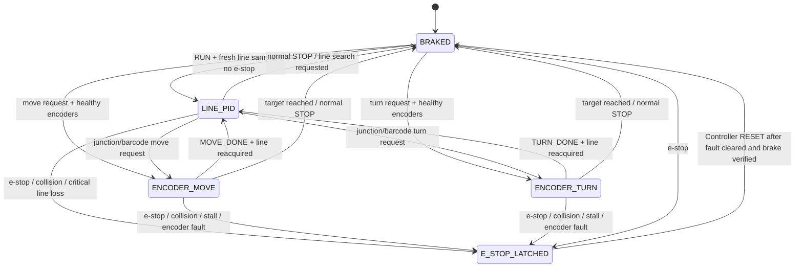

# Design-review feedback: integration handoff

The professor's detailed comments were shared on 19 October 2026. The
submitted design review PDF is a plan, not the currently implemented car.
This file records the edits Buddy 1 made and the decisions/measurements the
whole group still needs. Put confirmed values and evidence here as testing
progresses; do not report provisional numbers as measured results.

## Revised requirements to take back to the group

- **FR6 draft:** Detect an obstacle at least **300 mm** ahead in at least
  95% of trials at the agreed cruising speed. This is a trial threshold,
  chosen as 200 mm stop threshold plus 100 mm lead, **not yet based on measured
  braking distance**. Replace it after the braking experiment below.
- **D_stop draft = 200 mm**, matching the design's existing NFR2 trigger.
  During a trial, request braking if the forward distance is at or below
  D_stop. The physical minimum safe distance must exceed the worst measured
  stopping distance plus ultrasonic/servo latency and a margin. If it does
  not, increase D_stop and D_detect before allowing obstacle bypass.
- **Merge NFR6 and NFR7:** “During Wi-Fi/MQTT loss, driving tasks shall
  continue to meet their deadlines without waiting for the network; while
  connected, telemetry shall publish at least 5 Hz with a 1 s heartbeat;
  telemetry shall reconnect within 10 s after the network is available.”
  This combines the duplicate requirements without changing the design's
  stated choice to continue autonomous driving during a network outage.
- **Brake-distance experiment:** On the real track at agreed cruise speed,
  record ten stop trials. Mark where STOP is issued and where the chassis
  actually rests. Record the maximum distance, speed, sensor facing angle,
  echo age, and time from detection to motor braking. Set D_stop above
  `max stopping distance + (speed × worst detection-to-brake latency) + margin`.
  Set D_detect far enough beyond D_stop for confirmation before the car reaches
  D_stop. Repeat on low-grip and hump sections if relevant.

## Motion Control statechart 2, proposed replacement

Motion Control is the **only motor writer**. The Vehicle Controller requests a
mode and target; it does not write PWM. The generic “Interrupt Occurs” arrow
in the old chart should be removed. Fault transitions are based on specific
events. The group should review the exact rearm authority before adoption.

The motor task should check `flg_estop` or the Buddy 1 stop latch every 10 ms,
brake in the same cycle, and report the measured command-to-brake latency.
No motor test should rely on the current Buddy 1 hook alone: there is no
Motion Control motor task connected yet.

## Hardware and concurrency decisions

| Feedback item | Group action and evidence needed |
| --- | --- |
| GPIO IRQs share IO_BANK0 | Use **one short dispatcher** for GP2 and GP4 encoder A edges and GP7 ECHO edges. Timestamp/count and exit; processing runs in tasks. Do not install three competing callbacks. Motion and Obstacle owners must agree on this file. |
| Encoder rate and ISR cost | Record actual counts per wheel revolution, wheel circumference, maximum speed. Compute `edges/s = (speed_mm_s / circumference_mm) × edges_per_rev` per wheel, sum both wheels. Measure worst dispatcher duration at that rate and compare with 10 ms Motion budget; consider PIO only if the IRQ load is too high. |
| Barcode contradiction | GP28 is an **ADC** channel, so use sampled analog values, not falling-edge timer capture. A single ADC owner samples GP26/27/28 with explicit channel selection and timestamps. Deliver line samples every 5 ms and barcode samples every 1 ms. FIFO/DMA round-robin is an option if task timing cannot meet this. |
| Narrow bar timing | Measure the narrowest printed bar in mm and cruise speed. Its duration is `bar_width_mm / speed_mm_per_ms`. A 1 ms period gives that many samples per bar. Choose a minimum sample count for robust classification, then validate ≥90% decode success on real passes. |
| Shared ISR/task values | Do not treat `volatile` as an atomic snapshot. Pass encoder/barcode records through a message buffer or make a short interrupt-disabled multi-field copy. Timestamp each line error; Motion Control should brake/search when it exceeds the agreed age threshold. |
| Telemetry snapshot | Buddy 1 now copies a compact 24-byte snapshot under a `TA_INHERIT` mutex and decodes after unlock. Measure worst time that Motion Control waits on the mutex after integration; the current getter never waits. |
| HC-SR04 power | Test the actual unit at 3.3 V with repeated known-distance readings. If unreliable, use HC-SR04P or 5 V power with a safe ECHO divider/level shifter before connecting ECHO to the Pico. Do not feed a 5 V ECHO directly to GP7. |
| Servo pointing sideways | During COARSE_SCAN, schedule a forward-facing measurement often enough that the car can still brake before D_stop; document the worst forward-view gap at speed. Stop driving for FINE_SCAN/profile. |
| Hump accuracy | Linear acceleration contaminates accelerometer-only tilt. Measure at least ten passes over the actual hump at cruise speed and compare the reported peak with a ruler. Keep FR5 ±5 mm as an unverified target until data supports it. |
| Obstacle entry and IMU fault | Define which driving substates can enter OBSTACLE, not only LINE_FOLLOW. On IMU_FAULT, report loss of collision sensing and decide explicitly whether the Controller permits degraded line following or brakes. |
| Timing | Measure Motion, Line, Barcode, IMU, ADC owner, Obstacle and Telemetry WCET; total CPU utilisation must stay below 70%. Measure impact-to-`flg_estop` <25 ms and e-stop-to-motor-stop <100 ms. |

## One fault policy table to agree before integration

These are proposed policies, **not implemented motor behaviour**. Keep one
bit per fault in the shared mask; avoid separate top-level fault states for
each sensor. The Vehicle Controller owns rearm and degraded-mode policy.

| Fault bit | Detection owner | Initial response to agree | Reset/evidence |
| --- | --- | --- | --- |
| 0 motor stall | Motion | Latch e-stop and brake | Motor current/encoder timeout trial; Controller reset |
| 1 encoder fault | Motion | Brake during encoder move/turn | Missing/implausible pulse test; Controller reset |
| 2 IMU fault | IMU | Report loss of collision detection; Controller chooses brake or degraded mode | I2C disconnect/stuck-value test |
| 3 no echo | Obstacle | Stop forward travel if front clearance is unknown | Timeout and valid-range test |
| 4 Wi-Fi/MQTT loss | Comms | Report/reconnect; do not block driving under current NFR | Broker/router outage test |
| 5 line loss | Line/Motion | Bounded search or e-stop at agreed timeout | Real track line-recovery test |

Buddy 1 has defined binary MQTT topics, payload widths, boot session and
duplicate/stale command rejection in `buddy1-binary-protocol.md`. The 32-bit
session is not security authentication. Motor-enabled remote operation needs
a protected broker and a tested e-stop path.

## Immediate physical checks Levl can help with

1. Reflash the newly built **binary MQTT UF2** with the motor battery
   disconnected, run the broker and `scripts/mqtt-tool.py watch`, then send
   START and STOP with the same helper. Share the output and USB console lines.
2. Photograph the exact markings on the ultrasonic module and encoder/motor
   label, and measure wheel diameter. These settle power level, encoder count
   assumptions and the first safe speed calculations.
3. When the team has a working motor brake and secure fixture, measure stop
   distance and latency before obstacle or full-course trials.
